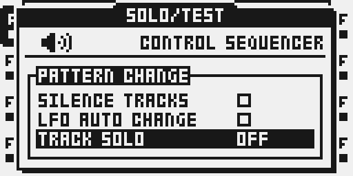
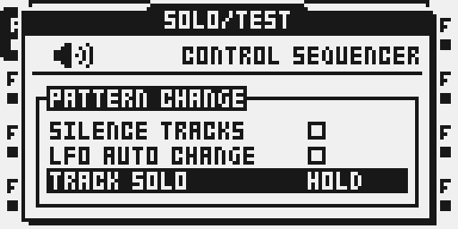

# Track Solo

Version `0.1.0-experimental` · author `twwwy` · **local prototype, not released**.

## Overview

Hold an audio TRACK button alone for two seconds to solo it temporarily. Keep
that original button held and tap other TRACK buttons to add or remove them.
Release the original button to end the entire operation.

Category: **system**. This is a performance control for audio tracks, with no FX
slot, DSP engine, MIDI generator, parameter lock or scene parameter of its own.

## Controls

| Control | Behavior |
| --- | --- |
| PROJECT > CONTROL > SEQUENCER > TRACK SOLO | OFF / HOLD; OFF by default. This setting is session-only. |
| A TRACK button held alone | The original press passes to stock; temporary solo after 120 instrument UI ticks, approximately two seconds. |
| Another TRACK button pressed during solo | Toggle that track once. Its release does not toggle it. |
| Original TRACK button released | End solo, including every joined track. |

The original track stays in the group. Further tracks can be released after
joining. They do not become new anchors. A repeat of a held key never toggles
membership. All eight audio-track buttons can join one operation.

## Usage

The USB prototype contributes its setting through the existing shared
`ot_sequencer_rows` table. It uses no private PERSONALIZE table or settings file.
The proposed shared PERSONALIZE table is not a dependency.

### Quick tutorial

1. Load the private candidate in an emulator. Open PROJECT > CONTROL > SEQUENCER,
   set TRACK SOLO to HOLD, close the menu, and let any stock notification clear.
2. Hold T2 alone for two seconds. While continuing to hold T2, press and release
   T3: T2 and T3 are now in the temporary group. Press T3 again to remove it.
3. Release T2. The underlying mute and solo state applies again. Select OFF to
   disable the gesture completely.

## Compatibility and limitations

- OS 1.40C. MKII emulator development first; physical MKII and MKI qualification
  have not been performed. MIDI mode is excluded.
- OFF is the initial state on boot, installation and package replacement. The
  enable setting and temporary group are never saved in a Part or project.
- The module changes only the level builder's working register. It never
  writes the canonical mute/solo word, cue routing, stored Parts or patterns.
  A muted track can be auditioned in the temporary group; its mute is retained.
  Existing solos are temporarily replaced, then resume on release. Stock or
  MIDI edits to the underlying state are retained rather than overwritten by
  a stale snapshot.
- Ordinary short presses remain stock. Any other key or encoder turn cancels
  arming or active solo and passes to stock, including FUNC/CUE combinations,
  recording, sample nudging, transport and menu access. Open stock popups and
  MIDI mode prevent arming. The physical key matrix is checked every UI tick
  so a release consumed by an earlier handler also cancels solo.
- Other tracks pressed during active solo do not change the selected track.
  Their matching releases are consumed even if the anchor ends first.
- No new LED or on-screen solo-group indicator is implemented yet. Stock mute
  indicators continue to show the underlying state.
- Master-track, Neighbor-chain, Pickup, cue-routing and automatic Part/pattern
  transitions need explicit qualification. There is no custom chain or master
  processing; the stock level builder still runs.
- Non-stock Mute Modes behavior is not qualified: it evaluates the canonical
  state before this overlay. Do not advertise that combination as supported.
  The open Track Mutes proposal also needs a deliberate gesture-compatibility
  decision before the two are offered together.
- Native card settings, public browser packaging, common-companion qualification
  and the complete USB review/trial/self-test/Keep/Undo lifecycle are pending.
  This draft is deliberately absent from the public catalogue.

## Tests and measurements

See [TESTING.md](TESTING.md). Host, compiled-code emulator, panel, DSP audio and
hardware results are recorded separately. A package that links is not a release.

The hold uses the instrument's UI tick because it is a wall-time button gesture,
including while transport is stopped. It creates no musical clock and changes
no sequencer timing, tempo, track speed or swing.

## Authorship and licences

Original module source by **twwwy**, under [MIT](LICENSE). Generation, packaging,
fixture creation and emulation use the existing Modwerk/Octabam/Elekloader SDK
and their existing licences. Generated test tones contain no factory samples.
No firmware, stock instructions, extracted tables, projects, card images or raw
memory dumps are distributed with this module.

## Screens and audio

Actual MKII emulator LCD captures show the enable row. They do not establish
hardware or audio qualification. A user-facing audio example is pending.

Choose HOLD with YES, then close the menu before using the hold gesture.

The thumbnail is a conceptual diagram, not an instrument screenshot or measurement.
